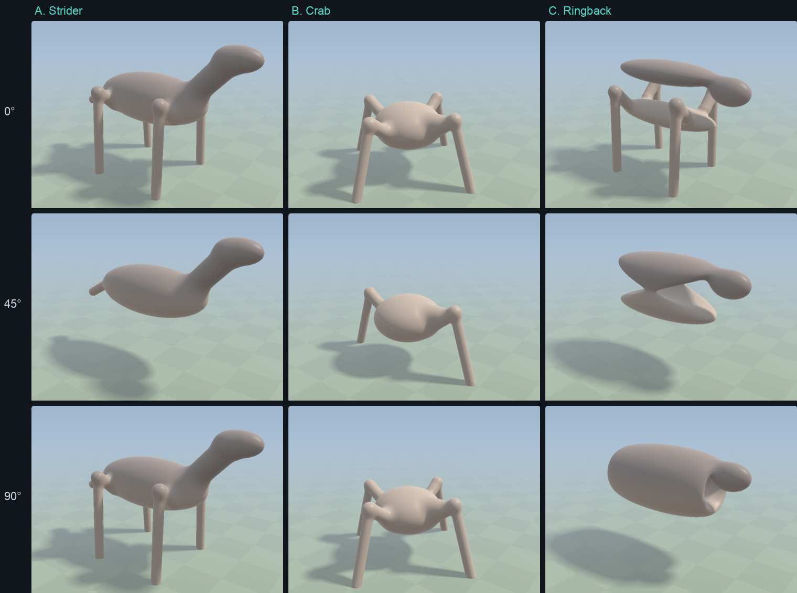

# Night report

The overnight build of 7–8 October (milestones M0 to M7), the day of refinements that followed on 8 October, run three on 11 October, which takes Glome to v1.0, run four the same day, which shows the way (v1.1), run five on 12 October, which fills the world where you are (v1.2), and run six the same day: Windows, creatures where they live and a cave you can leave (v1.3); their sections are at the end.

**Play:** https://bengreff.github.io/glome/ · **Hub:** https://bengreff.github.io/ · **Source:** https://github.com/bengreff/glome

Tagged v0.0 to v0.7 after the night; run three added v0.8 to v0.11 and **v1.0**; run four, **v1.1**; run five, **v1.2**; run six, **v1.3**. (After the night, v1.0 was held back for performance; run three met the revised gate of 60 fps at 50% or more with a far fuller world.)

## What to try first

1. Walk to the cairn ahead of you and press F on the big block. It comes up slowly (163 kg), swings when you turn, and the arc round the dot shows the strain. Turn through ana (right-drag) while holding it, set it down, turn back: it is its own mirror image.
2. Throw a ball (hold the mouse) near a roller (the duocylinders that circle you). It chases the ball and knocks it on. Listen to the ball land: it rings with a 3-sphere's overtones.
3. Look up, then turn through ana: the clouds change shape, because your slice cuts their 4D layer somewhere else.
4. Step through ana with Q and E and watch the boulders swell and vanish.
5. Find the cave 40 m toward the massif. Its only way in leaves the hill toward ana.
6. Climb to the summit (46 m, the highest). The launcher is there; the bowl beside it is a basin carved by a 4D ball.

## What shipped overnight (M0–M7)

- **M0, the base.** Glome renamed, main.js split into modules, every constant in js/laws.js, four Bach recordings (CC0) for the key moments.
- **M1, the physics core.** Gravity is exact: 1/r³, every mass with all its images round the hoop, in closed form. The planet's double spin, with its centrifugal and Coriolis forces and the star's tide. A capsule body, wading, saves and export/import.
- **M2, things.** 4D rigid bodies, written for the game: SO(4) rotations as quaternion pairs, bivector spin, contacts with Coulomb friction, buoyancy by displaced 4-volume, sleeping. Balls and tesseracts to carry, stack and throw, impulse stones that recoil you, lanterns with a 1/r³ pool.
- **M3, the crafted planet.** The great massif, an archipelago joined only through ana, rivers, a cave reachable only through ana, an arch, an overhang, three trees, and a rope that cannot hold a knot.
- **M4, space.** The hoop sky (a row of suns and your planet's copies), the launcher with four tiers, flight in the inertial frame, the space map that predicts your path, and planet B, a 120-cell you can walk on.
- **M5, life.** Walkers (eight legs as two alternating tetrapods) and rollers (duocylinders rolling by double rotation), and an ecosystem that persists.
- **M6, purpose.** Four wordless puzzles on A guarding the launcher's parts (the closed room, the mirror key, the knot gate, the antipode). On B, the orbit that unlocks the console, and the console itself: its screen holds the universe with itself in it, its dials change the laws, and it shows the game's source. The raft and the sail.
- **M7, polish.** Exposure and genuinely dark nights, the hub site, the README, the itch.io page and zip, two code reviews and their fixes.

## Day two: what you asked for

You asked for held objects to turn with you and move smoothly, entirely by physics, for bugs to be fixed, for polish and for more features.

- **Holding is physical.** What you hold stays an ordinary body, pulled to your hands by a drive of limited strength (2600 N, 400 N·m). It collides, sags when heavy and swings when you turn, and its reaction moves you, so momentum is conserved. It keeps its attitude to your body: it turns as you turn and as you twist through ana, and it stays level when you only look up or down, so things go down square.
- **Smooth motion at any refresh rate.** Frames are drawn between physics steps (the world steps at 120 Hz). What you hold is drawn where it sits in your view against your latest turn.
- **Things on planet B.** B has its own world of bodies with B's gravity and floors. What you carry there crosses with you and stays.
- **Wayfinding on B.** Marks show the console and the return pad, with their distances and which way they lie through ana. Without them the console, on one of 120 floors across a 3D surface some 360 m wide, was nearly impossible to find.
- **Climbing.** Hold Space and walk into a big block, the raft or the built blocks, and you climb them, as with boulders. That is how you board the raft from the water.
- **Sound.** Impacts by material (a struck ball rings at √(l(l+2)), the 3-sphere's modes), splashes, walkers' footfalls, rollers' calls.
- **Life.** Rollers play with rolling balls; walkers startle at things flying past.
- **Sky.** Clouds in a 4D layer 90 m up that change shape as you turn through ana, seen from above when you fly, and casting drifting shadows.
- **Looks.** Fine ground texture without stair-steps or streaks; Perlin detail noise (no blocky grass from above); leafier trees; the lantern glows its own amber; a cave is dim but never black; a real bowl on the summit.
- **Controls and settings.** Gamepads (standard mapping), field of view, invert mouse, and U to clear the view for pictures. The gaze dot opens out over anything you can take.

## Bugs found and fixed today

The ones a player would have met:

- **Every jump was a double jump** (10 m/s and 6.5 m high instead of 5.2 m/s and 1.4 m): a held key jumped again inside the 5 cm footing grace.
- **The ground near you broke into stair-steps on bright snow and smeared on grass.** GPU texture filtering places a sample between height texels only to 1/256 of a texel. Hits near you are now placed on precisely filtered heights.
- **Objects dropped on planet B fell through it.**
- **On B the sun, day and night were computed from planet A's centre**, 3 km away; on A, 7° off.
- **The raft tipped you into the sea.** A light raft floated at 28° because the buoyancy sampling was too coarse for its shallow draft, it never stopped bobbing because water's damping scaled with depth under water, and standing on its slightly tilted deck slid you off. All three were fixed: smooth buoyancy, damping by displaced mass, and footing that holds you as friction would.
- **The antipode's ball rolled out of the bowl.** It was a flat slab open in the third ground direction, and a ball on stone felt no rolling resistance.
- **Smaller ones** (several found by three code reviews):
  - the console's flying switch was taken over by orbital flight above 20 m;
  - the radar took clicks from stale data while showing the space map;
  - lifting the raft you stood on yanked you along;
  - fading home dropped what you held;
  - a far pickup dropped the object before it arrived;
  - a save made in mid-flight came back as an ordinary jump;
  - the resolution controller hunted, or pinned itself, on vsync'd displays;
  - finished sounds were never disconnected, so a long walk grew the audio graph without bound;
  - a gamepad unplugged mid-press left a throw winding up for ever.

All four puzzles were solved again by script with the real controls, after these changes: the mirror key, the knot gate, the antipode and the orbit. A save made while holding something reloads with it still in your hand.

## Cut, and why (unchanged from the night)

- **The double dial:** it needs a way to turn things in two planes at once by hand.
- **The linked rails:** Clifford-parallel rails on this planet would be great circles 1.6 km long.
- **A third species:** the design's first cut.
- **B's other artifacts:** the design's cut line kept only the orbit and the console.
- **Tacking with the sail:** the sail is square-rigged.

## Performance

M2 Pro, 3024 × 1964 (dpr 2), default view:

| | Resolution at a steady 60 fps |
|---|---|
| Morning | 59% |
| Now, default view | 52% |
| Now, looking down at near ground (the costliest view) | 48% |

The gate was 60 fps at 60% or more, so it is not met. Today's quality fixes cost about 4 ms a frame:

| Cost | ms per frame |
|---|---|
| Precise hit placement | 1.3 |
| Clouds and their shadows | under 1 |
| Tetraplanar detail | 0.5–1 |

Savings went the other way: objects and trees 1.7 → 0.5 ms; shadows trimmed. Shadows remain the largest single cost (about 3 ms). Measurements late in the day were noisy because other workloads were using the machine.

## Known issues

- **Performance gate:** see above. The game holds 60 fps by lowering resolution, and the sharpening upscale keeps it crisp, but at about 52% rather than 60%.
- **Audio** has been checked in code and in the browser (events fire, nothing throws), but not listened to.
- **Walkers' legs** are thin 4D capsules, so a slice rarely cuts them.
- **True night is rare** (about 4% of the time): the row of suns spans the sky, so most nights are long twilights. This follows from the hoop sky and was not tuned away.
- **Spin tilts "level" by up to 3° on the summit**, so balls on smooth stone creep. The ground's rolling resistance stops them on grass. This is physics, kept.

## Decisions

Every non-trivial choice, with its reasoning, is in [DECISIONS.md](DECISIONS.md): "Night decisions" for M0–M7 and "Day two decisions" for today. The physics claims and the approximations are in [PHYSICS.md](PHYSICS.md).

## For you

1. **itch.io:** upload `dist/glome-v0.7.zip` (built; it is gitignored, so rebuild it with `tools/package.sh` on another machine) as an HTML game, using the settings and text in [ITCH.md](ITCH.md).
2. **The hub:** approve or edit the copy on https://bengreff.github.io/ (repo `bengreff/bengreff.github.io`).
3. **v1.0:** tag it when you are happy with performance. Lowering the shadows' cost is the most direct way to the 60% gate, or the gate could become 60 fps at 50%.

## Run three (11 October): to v1.0

You played v0.7 and said the world was empty, gravity too weak and the radar cluttered. This run raised gravity, gave the radar layers, filled the planet, added wordless guidance, and ends at v1.0. Tagged v0.8 (gravity), v0.9 (radar), v0.10 (a full world), v0.11 (guidance) and v1.0.

### What to try first

1. Look around where you arrive: whole trees, a conifer, a birch, two crystals and a slab stand in your first slice. Turn through ana (right-drag) a little and watch them come apart into floating crowns and rock sections, and others come in.
2. Walk to the column of light over the hill ahead. It stands over the cave, the first artifact; there is one over each artifact you have not solved, and one over any launcher part left lying. Each one is seen when your slice passes near it.
3. Press 1–9 to switch the radar's layers, or L for its legend (with the mouse free, click a row). Things, landmarks and your trail are on at first; the trail fades over two minutes. The pulsing mark is the nearest artifact still to solve.
4. Find the ring of pillars about 30 m from the start. It stands on a sphere, so your slice shows a circle of pillars, a different one each time you turn.
5. Meet a herd (they live near the start, on the way up to the summit and by the artifacts). Most walkers step out of your slice through ana as you come; the curious third step into it and stand a few metres off, looking at you. Rush at one and it bolts.
6. Jump: you rise about 1.25 m where you mostly walk, and nearly 2 m on the summit, where gravity is Earth's.

### What shipped

- **N1, gravity: Earth on the summit (v0.8).** Planet A's surface gravity is 16 m/s² (was 9.8), chosen so that the summit, as you walk it (42.5 m), measures 9.8 m/s² averaged over the day with the game's own field: the hoop's images and the spin included, 8.7–10.2 as the light zones pass. Sea level averages 15.8. Re-derived by integration: the launcher's tiers (28, 43, 53, 72 m/s: a 60 m hop, a 200 m arc, the orbit across the hoop, B), the jump (6.0 m/s), the hold (4200 N, so the 163 kg block and the 171 kg raft still come up). Throws are unchanged (a throw is muscle). B keeps 6 m/s².
- **N2, the radar (v0.9).** Nine layers on keys 1–9 (things, landmarks, creatures, water and coast, solid mountains, height shells, summit peaks, boulders and rocks, trail), with a legend beside the ball that shows when you open it (L), when help is up, when the free mouse is over the radar, or for a moment after a key; a click on a row switches it. The caption and the long legend text live in the legend now. The trail fades by age over two minutes.
- **N3, a full world (v0.10).** The numbers come from the slice's geometry: your slice shows a 2D sheet of the 3D ground, so a thing is seen only when your slice passes within its own half-thickness of it, and the ground needs several times the density a 3D world would to look furnished. About 12,000 trees and shrubs in 95 groves and woods plus 3,000 single trees and 4,000 shrubs over the grassland; 5,800 rocks; 220 walkers and 50 rollers; 73 ruins, 133 caches and 122 cairns.
  - **Trees:** broadleaf trees, conifers whose needles are 4D cones, birches, dead trees, shrubs. Leaves and needles are porous (ragged edges, gaps you see through); crowns shade the ground softly. Trunks stop you.
  - **Rocks:** tesseract slabs and blocks, 16-cell and 24-cell crystals, duocylinder river stones, flattened balls, scree; granite, sandstone, pale crystal, basalt. Solid, climbable when big, sharp shadows. Their slices change shape as you turn. Boulders stay, as one kind among several.
  - **Creatures:** walkers are larger (a metre high), a third of them curious; herds live where you will go. Only the creatures within 70 m are moved every frame; the rest step coarsely when they think, which is all the ecosystem needs.
  - **Things to find:** ruins built for four dimensions (a ring of pillars on a sphere, a room whose walls are 3D cells, a gate, steps), caches of balls, blocks, lanterns and impulse stones, cairns you can knock down, and lines of cairns leading from the start toward each artifact and the launcher.
- **N4, wordless guidance (v0.11).** Four sockets set into the launcher's pad light (with a chime) as their parts arrive; a full set lights the pad. Columns of light stand over unsolved artifacts and loose parts, 150 m tall so they clear the horizon out to about 300 m. The radar pulses over the nearest unsolved artifact.
- **N5, polish (v1.0).** Rocks weather differently facet by facet, with lichen; bark and birch bark are quieter; the help text, README and the itch.io page describe the new things; a code review of the run's diff and its fixes.

### How it stays at 60 fps

The world now holds some 30,000 things, and the gate (60 fps at 50% resolution or more) held because the renderer was rebuilt underneath it:

- **The view is drawn in two passes:** what each pixel's ray meets, then its colour. The one big program had grown so large that the GPU could keep few pixels in flight; split, the default view's slice pass went from 14.1 ms to 11.9 ms at 50% before any new content. The ground's soft shadow (and the crowns') is computed in a third pass at half resolution.
- **Per screen tile, only what can be seen:** each frame the CPU keeps the trees and rocks your slice cuts, gives each a circle on the screen, and lists them per 32-pixel tile; a pixel tests only its tile's list, nearest first. Rock shadows have their own list. A cut clump of leaves goes up as a 3D ball in the slice's own coordinates.
- **The resolution controller** no longer pins itself high (it undid steps down whose gain was lost in frame-to-frame noise).

M2 Pro, 3024 × 1964 (dpr 2), the resolution the controller settled at, at 60 fps (the machine was shared with other work; load average 1.5–2):

| View | Resolution |
|---|---|
| Where you arrive | 55–58% |
| Inside a pine wood | 54–55% |
| Among a herd | 59% |
| Looking down at near ground | 61% |
| Beside a rock outcrop | 56% |

The gate was 60 fps at 50% or more in each: met. (v0.7's default view was 52–54%, with an empty world.) The slice pass alone at 50% now costs 12–15 ms depending on the view; the CPU's share of a frame is about 4 ms.

### Bugs found and fixed on the way

- **Flight round the hoop.** A launch straight up while "up" points along the hoop rises past halfway to A's copy 800 m along it and comes down on A's far side. Flight didn't wrap round the hoop, so it fell into the copy's point mass and was flung off at 3 km/s. Found while re-deriving tier II, which does this at about half the times of day (the old tier II too).
- **The space map promised landings on B that missed:** it counted anything within 126 m of B's centre, but B's floors stand 115–124 m out. It now lands exactly where flight does.
- **The hoop field overflowed** beyond about 40 km (sinh and cosh past 10³⁰⁸).
- **From the code review of the run:** the screen tiles' index list could outgrow its texture on a very large screen; the tiles' scratch arrays were made anew each frame; the radar scanned all 21,000 trees each frame for the few landmark ones; a save from a world whose finds were made differently could duplicate a found thing.

### Cut, and why

- **Tree shadows are soft balls, not branch-exact.** Exact shadows of thousands of capsules would cost several milliseconds; the crowns' shade is soft and partial, which is how foliage shade reads anyway.
- **Ruins and rocks are static.** Knocking a pillar over would need them to be bodies; cairns are bodies instead.
- **No third creature species** (the design's first cut, unchanged).

### Known issues

- **A slice is sparse by nature.** Even with 30,000 things, a turn through ana of 20° empties a view of everything more than a few tens of metres away: that is the 4D world, not a bug, and the radar shows what your slice misses.
- **Load time** is about 3.8 s on the M2 Pro (the world's woods, rocks and finds add 0.9 s).
- **Orbits are as marginal as before.** The flight drifts from the space map's prediction by a few metres a minute at first, so an orbit that skims the hills can still be lost.
- **True night is rare** (unchanged): the row of suns makes most nights long twilights.
- **Audio** is checked in code and in the browser, not by ear.

### Decisions

Every choice made in this run, with its reason, is under "Run three decisions" in [DECISIONS.md](DECISIONS.md); PHYSICS.md has the new numbers (gravity, the launcher table, rocks, trees, creatures).

### For you

1. **itch.io:** upload `dist/glome-v1.0.zip` (built with `tools/package.sh`; it is gitignored) as an HTML game, with the settings and text in [ITCH.md](ITCH.md) (updated for the new things).
2. **The hub:** approve or edit the copy on https://bengreff.github.io/ (unchanged since day two).
3. **Play it with sound on.** The new things make few sounds of their own (rock underfoot, a chime when a socket lights); listening is the one check I could not make.

## Run four (11 October): the way (v1.1)

You played v1.0 and said: the column of light should be clearer; you found nothing and no creatures; at the column there were only rocks you could not use; the radar was still cluttered and unclear; it must be possible to figure out what to do. I played it as a new player in the headless browser first, and you were right on every count:

- **The column you walked to led onto a hilltop above the cave.** It stood over part I, which lies in the chamber 7.5 m under the hill; the only way in is a tunnel whose mouth lies 16 m toward ana. Walking to the column put you on solid ground over the chamber with nothing to do, and the column, by then all around you, turned into a fog.
- **The creatures were there and did not look like creatures.** Four walkers stood within 11 m of the start, behind you: grey metal boxes on thin dark legs, which a slice mostly misses.
- **The "rocks you could not interact with"** were the cave's arch: blocks of the same pale stone as the cubes you can carry, but fixed.
- **The radar held some forty marks** at the start: every block of every cairn, every ball of every cache, every wood as a green patch, trees, and labels.

### What changed

1. **One goal at a time, and a guide that says how to reach it.** A diamond marks the goal in your view (on the screen's edge, with an arrow, when it is behind you), with its distance. When the goal lies off your slice, a key and a caret beside it say which way to step and how far: **E ▲ 16 m** (toward ana, orange) or **Q ▼** (toward kata, blue), the radar's colours. At the goal's place the same cue grows under the dot, and when there is something to do there the key under the dot says it: F to take or set down, Z C and a half-turn to turn the mirror key through ana, E to slip the knot's loop off its post, Space on a charged pad. A small F also appears whenever the dot rests on something you can carry. The goals run in the artifacts' order: the cave's mouth, its chamber, part I, the launcher's pad, the mirror key and its socket, the knot's rope, the bowl, and each freed part back to the pad.
2. **The column of light is the goal's, and it stands in your slice.** Straight up from the goal's place, moved along ana into your slice, so you see it whichever way you face; a bright core with a soft halo; dashed (the dashes rising) while the goal lies off your slice, solid once it is in; faded as you reach it, so it never fogs the view. Warm white over the launcher's pad, the accent colour elsewhere.
3. **The cave is enterable by following the cues.** The first goal is the floor of the mouth's hollow; in the tunnel the goal becomes part I, 15 m toward kata, and the cue says Q. Eight posts of dark stone ring the mouth, and a lantern lights the chamber. A new playthrough (tools/playthrough/pt_room.js) follows the cues with real keys from where you arrive: it steps through ana, walks to the mouth, steps down the tunnel into the chamber, takes part I, and the guide turns to the pad.
4. **Walkers are animals.** A tawny body with a dark barred saddle, a head with two eyes, legs under it. Near you a walker turns square to your slice, so that its eyes and four of its eight legs are in it and it stands like a four-legged animal (the other four legs stand off your slice). Most are curious now (60%) and notice you from 30 m; shy ones trot away in your slice, and only a third of those leave through ana. Five graze in your first view. Rollers are glazed in two colours, checked by their two angles, so you see them turn in two planes at once.
5. **Fixed things look fixed:** the builder's dark stone with faintly lit edges. What you can carry stays pale.
6. **The radar keeps to what matters.** The goal is its brightest mark, on a stalk, with a dashed line from you along the disc. Every mark stands on a stalk to the disc, orange up toward ana, blue down toward kata, so its length is how far it lies off your slice. An untouched cairn is no longer a "thing"; an untouched cache is one mark. Woods and trees are gone from it; the compass letters, the sun's height, the scale and the gaze distance show on the big radar (Tab) or with the legend up.

### What to try first

1. Look at the diamond ahead and the cue beside it (**E ▲ 16 m**). Hold E: the dashed column turns solid as the cave's mouth comes into your slice. Walk to it, down into the hollow, and hold Q as the cue says.
2. Look a little left from where you arrive: a small herd grazes there, and most of it comes over to look at you. Rush one and it bolts.
3. Take part I in the chamber (F) and follow the warm column to the launcher; set it down in the ring (F) and its socket lights.

### Gates

- **Unit tests** all pass (so4, bodies, rope, audio, creatures). **Smoke:** no errors, boot 4.4 s (with another session's jobs keeping the Mac's load at 7–12).
- **Performance** (M2 Pro, 60 fps at 50% resolution or more): start 56.9%, in a wood 55.8%, at a herd 58.7%, looking down 60.9%, at an outcrop 56.9%, each at 57–60 fps.
- **Persistence:** save and reload, export and import, and the found things' saves (27 KB) all pass.
- **Playthroughs:** the cave by its cues (new), the mirror, the knot and the antipode all solve, and the guide turns to the freed part after each; tier IV lands on B (61 s, predicted 60). The orbit's first run picked a path whose low point was 349 m and came down before a full turn; run again, it went round (low point 395 m). Orbits remain as marginal as the Known issues of run three say.

### For you

1. **itch.io:** upload `dist/glome-v1.1.zip` (built with `tools/package.sh`) in place of v1.0, with the settings in [ITCH.md](ITCH.md).
2. **Play the first five minutes again** and tell me where the cues still leave you guessing. The cave, the carry to the launcher and the mirror's cues are checked on screen; the knot's and the bowl's cues are checked in code and by their playthroughs, not by eye.

## Run five (12 October): a full world where you are (v1.2)

You played v1.1: the goal was clear, but you saw zero creatures and few trees or plants, and "landmarks" was a vague name. I measured before changing anything: at 300 random spots on dry land, facing random ways, your slice cut a median of 8 trees and 2 shrubs within 100 m, and 98% of views had no creature within 60 m. The reason is the 4D slice: the ground is three-dimensional and your slice shows a sheet of it only as thick as the things in it, so a world stocked like a 3D one looks empty, and the smaller the thing, the emptier.

### What changed

1. **Plants, grown where you are.** Bushes, flowering shrubs and heath, cushions of flowers, tufts of grass and young conifers, within 36 m of you (the smallest within 22 m), grown afresh as you walk and the same every time you come back; spread evenly over the whole 3-sphere, thicker in meadows, sparse up on the rock. They are made of what a slice can cut (balls of leaves, cones of grass, flowers sitting on leaves), so they come and go as you turn, like everything else. You walk through them.
2. **More trees:** 31,000 (was 21,000), more of them conifers.
3. **Creatures: some 3,000 walkers in 250 herds and 500 rollers** (were 220 and 50). Curious walkers notice you from 100 m (was 30) and trot into your slice; rollers circle you from 80 m. Standing still at eight random spots for 25 seconds, creatures came into view within 45 m at seven of them (2 to 17 each).
4. **Herds no longer die out.** The old rules let herds merge, stop breeding and die off in waves (to a fifth within a day of play): likely why a long session showed you none. Now lifespans vary, and a young walker born into a crowded herd wanders off to found a new one; the population holds steady over twelve days of the test.
5. **Rollers have eyes** and a duller two-colour glaze, so they read as animals rather than glass.
6. **The radar's layers say what they hold:** "things to carry" and "places: cave, ruins, launcher, artifacts". By default it shows those two, the goal and your trail.

### Gates

- **Unit tests** all pass; the creatures' test now runs 2,500 walkers and 400 rollers for ten days (they hold at their caps, 3,000 and 500). **Smoke:** no errors, boot 4.3 s.
- **Performance** (60 fps at 50% resolution or more): start 58.7%, in a wood 53.6%, at a herd 55.2%, looking down 58.8%, at an outcrop 54.2%, each at 58–60 fps. The plants cost 0.2 ms of GPU time once grouped a plant at a time (3 ms grouped by place, the first try).
- **Persistence:** save and reload, export and import, and the found things all pass; a save is now 207 KB (was 28 KB), nearly all of it creatures.
- **Playthroughs:** the cave by its cues, the mirror, the knot and the antipode solve; the orbit goes round (low point 365 m); tier IV lands on B (71 s, predicted 69).

### For you

1. **itch.io:** upload `dist/glome-v1.2.zip` in place of v1.1.
2. **Play somewhere away from the start and stand still for half a minute.** Tell me whether it now feels inhabited, and whether the plants are too many, too few, or wrong in kind.

## Run six (12 October): Windows, creatures where they live, a cave you can leave (v1.3)

You played v1.2: it would not load on Windows and froze the browser; the creatures chased you instead of being spread evenly; and in the cave you were trapped.

### What changed

1. **Windows.** I have no Windows machine to test on, so I fixed the two known causes of exactly this freeze. Every shader was compiled and checked the moment the page loaded, before the loading bar could move; on Windows the browser translates them for Direct3D, whose compiler is far slower, and the check held the page frozen until it finished. Now the compiles start at once and are checked only after the world is built, in the background where the browser allows, with "Preparing the view (compiling the shaders, n s)…" on screen. And the terrain's ray march read its height texture with automatic mip levels inside a long loop, which Direct3D's compiler can only handle by unrolling the whole loop: a compile that can take minutes. Every lookup inside a loop now names its level; a scan of the shaders finds no other. Boot also yields between its long steps and says what it is doing.
2. **Creatures live where they live.** v1.2 had curious walkers notice you from 100 m and come over, so a crowd gathered and followed you. Now herds are spread evenly over the planet, like the plants, each grazing about its own home; the same herds are there when you come back. Come close and the shy ones trot off, the curious ones stop and watch; none follows you from its home ground. There are many more of them (about one walker to 600 m³ of grassland), and walkers are 1.4 times larger, so you meet them wherever you go: at twelve random places, on arrival, creatures were in your slice within 60 m at all twelve and in your view at ten.
3. **The cave.** You were trapped by its shape: the tunnel left the round chamber partway up its side, and the last metre before it was a concave wall steeper than 60° that stopped your knees. Now a level passage leaves the chamber at its floor and the tunnel climbs from it at no more than 30°; the mouth's hollow is a metre deep with gentle sides. While you are inside, the guide points the way out. A new playthrough goes in with real keys, takes part I and walks out, following the cues.

### Gates

- **Unit tests** pass; the creatures' test is new: herds near wherever you stand (458 creatures within 40 m at the median of 80 random places, none without), none strays from home (at most 0.6 m past its leash, fleeing) and none of a herd is within 30 m of you after you walk 120 m away. **Smoke:** no errors, boot 4.2 s on the Mac.
- **Performance:** start 58.2%, in a wood 55.2%, at a herd 58.8%, looking down 60.2%, at an outcrop 56.4%, each at 58–60 fps. The main thread's frame work is 3.8 ms (was 2.3 before the plants and herds).
- **Persistence:** all pass; a save is 7.8 KB (the creatures are no longer in it).
- **Playthroughs:** into the cave and out of it by the cues (new); the mirror, the knot and the antipode solve; tier IV lands on B (206 s, as predicted). The orbit's first pick skimmed the hills (low point 346 m) and came down, as in run four; the playthrough now asks for a low point above 360 m, and went round (361 m).

### For you

1. **Try it on Windows** and tell me what the loading screen says if it still stops: it now shows each step, and how long the shaders take to compile. If a shader fails, it shows the error instead of freezing; a copy of that text would let me fix it.
2. **itch.io:** upload `dist/glome-v1.3.zip` in place of v1.2.

## Run seven (12 October): four puzzles rebuilt, keys you can see, stones that come back (v1.4)

You played v1.3: you got the first key from the cave, but had no idea what the second puzzle wanted (you stacked its key on the model). You asked for keys you can recognise, impulse stones that come back, a cue to stow one, clear places on the launcher, and better creatures. We did an interview first (the answers are HANDOFF.md §3a). You were here for the first segments, then left me to carry on.

### What changed

1. **Keys are brass rings**, the only brass in the world. They are threaded onto a pillar beside the launch pad: a thin spindle with four balls, smaller going up. Let a ring go over the spindle and it drops past every ball smaller than its hole and rests on the one that fits. Its ball lights, and the tier is the rings resting, counted from the bottom. Taking a ring makes its ball pulse and the guide point to the pillar.
2. **Impulse stones come back.** Every ruin and cairn has a pedestal where a stone forms over three minutes. F takes a stone into your hand like anything else. G puts it in the pouch, or takes one out. The pouch holds nine, shown under the radar.
3. **The four puzzles are rebuilt as structures,** on level, dry ground. The guide shows only where they are, never what to do.
   - **I. The closed room**, 14 m from where you arrive. You can see ring I on a plinth through a grille. In your slice the room is walled on every side, roof included, but its walls reach only a metre toward ana. Step round them through ana and back: you're inside.
   - **II. The mirror key.** A mould on a plinth, half its cells solid, and a brass key that is the empty half's mirror image. As found it jams. Turned half a turn through ana in your hands (R and right-drag sideways), it slides home and the house beside it opens.
   - **III. The knot gate.** A heavy leaf in a doorway, hung by its foot and leaning in. A rope from its top runs to a loop over a capped peg. In 3D the loop is captive. In 4D the peg is as thin toward ana as across, so a short step through ana while holding the loop lifts it off, and the leaf falls in.
   - **IV. The fold** (replaces the antipode). Dalí's cross of eight cells, a tesseract's net, lies flat. Lift the six plates round the middle on their hinges (two of them are toward ana: turn to see them), turn the last over as a roof, and they close into a tesseract. A chest opens on ring IV.
4. **Aiming the launch.** The launcher throws you along a barrel on a gimbal beside the pad, not along your gaze. Three sliders on a stand set it: round, toward ana or kata, and up.
5. **Physics** (the details are in DECISIONS.md):
   - Bodies built of boxes, balls and capsules, with full 4D inertia.
   - Hinges that leave one plane of turning, with stops and catches.
   - A rope that holds a heavy body.
   - Contacts that can't create energy.
   - Box contacts that see the true gap at a corner.
   - Stepping up onto low edges.
6. **Hands.**
   - R and the mouse turn what you hold, including through ana. On a gamepad, click the right stick and turn it with that stick.
   - Things on a hinge or a rail are held by the point you took.
   - The doorways were too low to walk through (1.9 m, and you are 2.05 m tall); they are now 2.2 m.

### What I measured for you

- **The star is right as you see it**: one sun, or a short-lived row, fading in and out as your slice sweeps past the copies along the hoop.
- **Drift in a jump is real.** About 20 cm, mostly from A's own copies pulling sideways (0.4 m/s² at the median), plus a little Coriolis.
- **Seeing yourself round the hoop happens about 30 times an hour, for about 17 s each time.**
- **Tides** (below, a decision for you).

### Two decisions for you

**1. Tides.** I computed the equilibrium tide with the game's own gravity (A's copies round the hoop, the star, B, and the spin's centrifugal pull), integrated over the sea's surface:
- **Across the planet at any moment:** the sea's surface would stand 11–12 m higher in some places than in others.
- **At any one place:** the sea would rise and fall about 9.5 m (between 4 and 12 m) over 600 s, two of A's 300-second days. That's a tide every two and a half minutes.
- **On gentle shores**, the water's edge would move faster than you walk.
- **On the real sea it would be wilder still.** The forcing turns in two and a half minutes, about as long as a wave takes to cross the sea: shallow water a few metres to 15 m deep carries a wave at roughly 9–15 m/s, so 100–180 s round the planet. The water would slosh rather than settle into the equilibrium shape, and showing that would need a simulation of its own.

It would reshape the beaches, the raft's shore and the islands joined through ana, and some low places would flood twice every five minutes. Realism says build it; it changes the world enough that I'd rather you chose.

So I built the equilibrium tide but left it off. To see it, open the game with `?tides` at the end of its address, or turn on ≈ in the console. Then choose:
- (a) the true tide, always on;
- (b) the true tide, with the planet's day made slower so the tides come every few minutes rather than every two and a half;
- (c) no tide (as it is now);
- (d) the true tide, and a sea that sloshes (a project of its own).

**2. The hoop lighthouse puzzle** (your idea from the interview). Here is a proposal; it isn't built.
- **The tower.** A lit tower stands where the hoop's direction often lies level.
- **Seeing yourself.** When the hoop lies level there, look along it and you see the tower's own light on the rim of the planet's copy in the sky, 800 m away, blinking as the planet turns.
- **The beam.** The tower fires a beam you aim with sliders, like the launcher's barrel. Aimed exactly along the hoop, the beam goes round the universe and comes back from behind, into a detector on the tower's back. Because the hoop's direction turns with the planet, you aim where it will be and wait for the moment. Often that's partly toward ana: the detector lights only if you aimed through ana too.
- **What it needs:** the planet's copies would have to be drawn with their towers (today they are only ground and sea).
- **The "waves as gradients" idea.** In four space dimensions a pulse of light leaves a fading tail behind its front, but at light's speed the tail is far too short to see. Sound would show it, but there is no air between the copies. So I'd leave that out unless you have another use for it.

### Creature concepts (segment eight): pick one

You asked for creatures that are elegant and complete: one smooth skin each, animal and visibly 4D. Here are three concepts, each a single blended 4D surface, shown as your slice of it at three turns through ana (in the plane of its side and ana):

- **A. Strider:** a long body on eight legs, four at each end: left, right, ana and kata. Square to it, a four-legged beast. Turned 45°, the legs are cut to stubs and it seems to float. At 90° it stands on its other four.
- **B. Crab:** a round body with a leg along each of the ground's six directions. Square to it, it stands on four. At 45° only the front and back legs remain. At 90° the ana pair stands where the side pair was.
- **C. Ringback:** a body that is a ring through ana. Square to it, your slice cuts the ring twice: two backs, one over the other. A quarter turn shows the whole ring, a hollow tube, with its legs gone into ana.

To see them turning, serve the repo (`tools/serve.sh`) and open http://127.0.0.1:8650/tools/concepts/creatures.html (a slider sets the turn). Tell me which, or which parts of each, and I'll build it with walking legs and the herds' behaviour.
